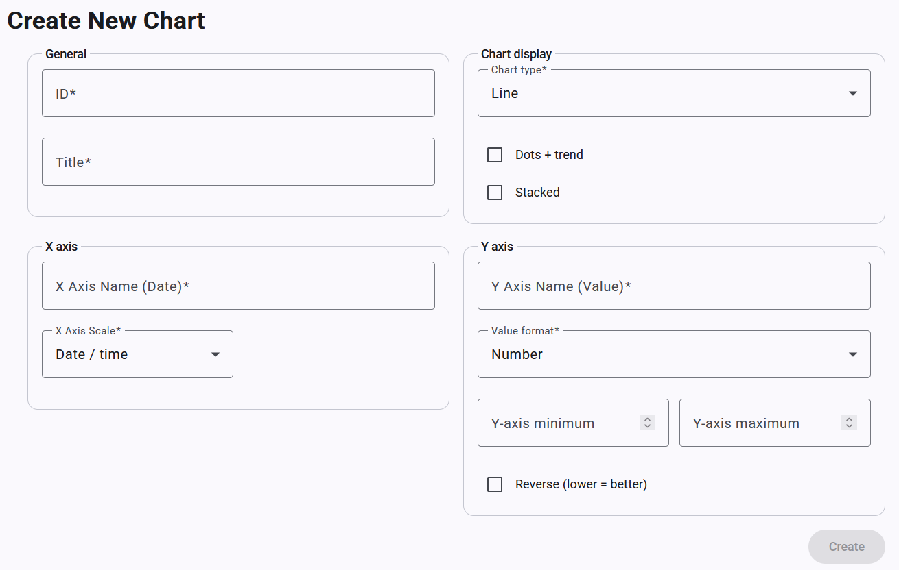
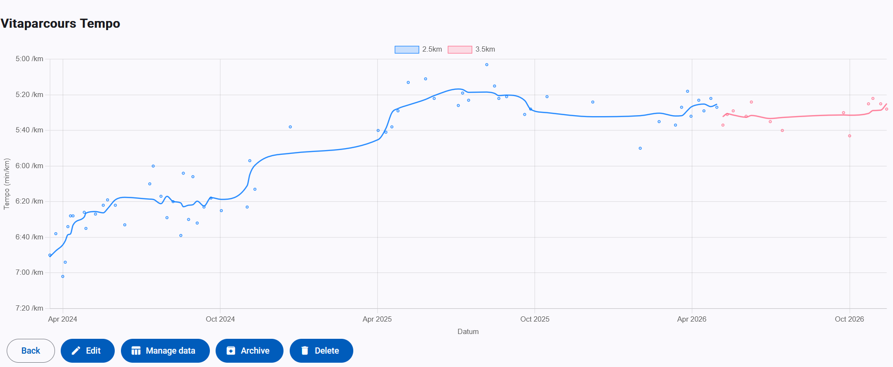
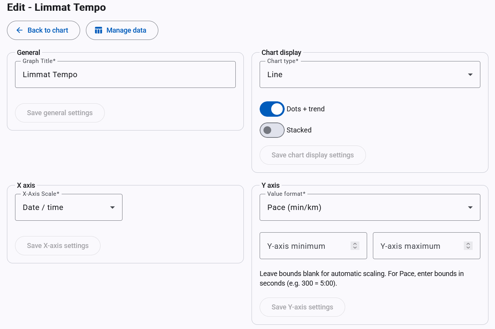
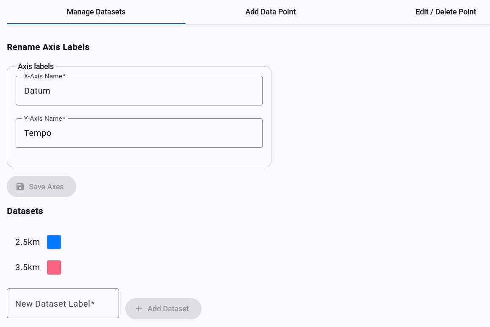
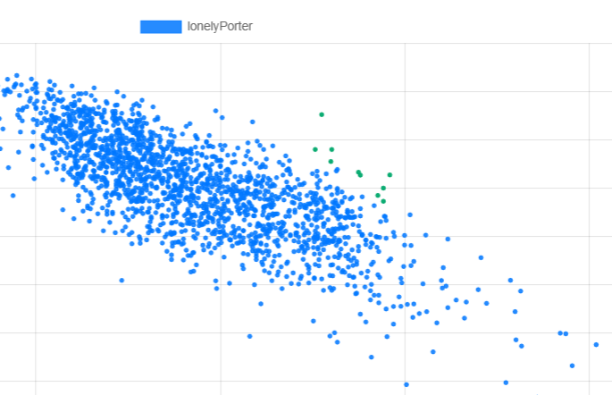
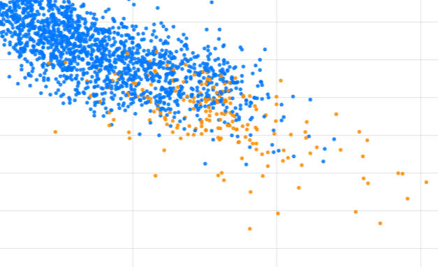
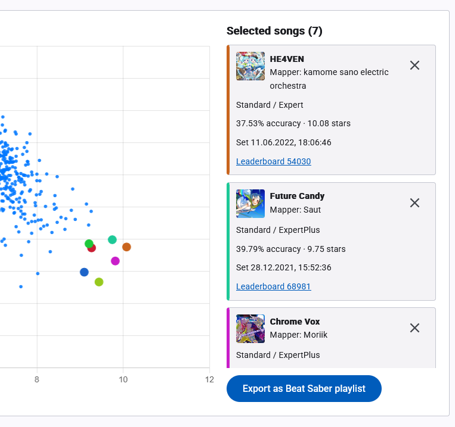
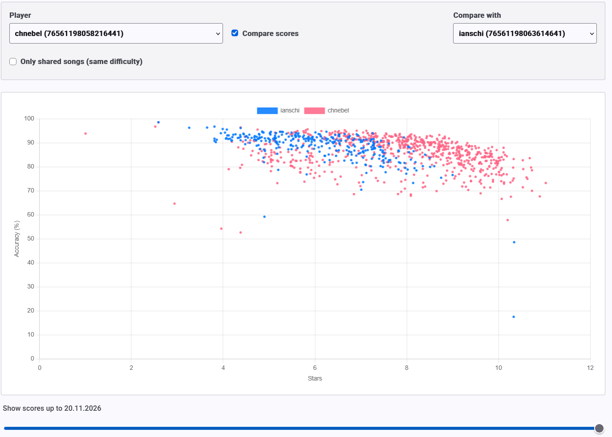

# Overview

The overview shows a card for each active (not archived) chart. Each card includes a chart preview. Select
**View Details** to open the full chart and its edit and data-management options.

## Chart Types

### Line Chart

#### Default

A line chart connects the points in each dataset. Dataset lines can be filled or unfilled.

For line charts, you can smooth a dataset's line. The smoothing window controls how many measurements are used.

When smoothing is enabled, you can also choose whether to fill gaps of at least 7 days. Without this option, the line
can appear flat across gaps between measurements:

Without filling the gaps:

With filling the gaps:

#### Stacked

Same as a normal line chart, but the datasets are stacked on each other, this needs at least 2 datasets to work.
Can be filled or unfilled

#### Dots & Trend

Instead of having all dots connected, the dots are still visible, but the line is replaced with a trend line, which is a
smoothed version of the normal line.

### Bar Chart

Shows the data points as bars. You can choose whether to stack them.

 

## Value Types

There are three value formats: Number, Percentage, and Pace.

### Number

Number is the default format. For a numeric X axis, you can optionally enter a unit, such as `km`, which is displayed
with the axis values. To show a unit for Y-axis values, include it in the Y-axis name.

### Pace

Enter pace as `m:ss` or `M.SS`. In `M.SS` notation, the part after the dot is the seconds field; a single digit is
treated as tens of seconds, so `5.1` means `5:10`. If you enter two digits, they must be from `00` to `59`: `5.59`
means `5:59`, while `5.60` is invalid.

### Percentage

Enter a percentage directly, or enter a count and set the dataset's **100% target**. The chart displays the count as a
percentage of that target.

## Creating a Chart

Select **New Statistic** and fill in the chart settings:

| Field                        | What it controls                                                                                                                                        |
|------------------------------|---------------------------------------------------------------------------------------------------------------------------------------------------------|
| **ID**                       | A unique identifier for the chart.                                                                                                                      |
| **Title**                    | The title shown above the chart and on its overview card.                                                                                               |
| **Chart type**               | **Line** connects measurements; **Bar** displays them as bars.                                                                                          |
| **Dots + trend**             | For line charts, displays the recorded points and a trend line.                                                                                         |
| **Stacked**                  | Stacks datasets together for comparison.                                                                                                                |
| **X Axis Name**              | The label shown for the horizontal axis.                                                                                                                |
| **X Axis Scale**             | **Date / time** places measurements by date; **Numeric** places them by number. Numeric scales also have a **Numeric X Axis Unit** field, such as `km`. |
| **Y Axis Name**              | The label shown for the vertical axis.                                                                                                                  |
| **Value format**             | **Number**, **Pace (min/km)**, or **Percentage (%)** controls how values are displayed and entered.                                                     |
| **Y-axis minimum / maximum** | Optional lower and upper bounds. Leave blank to use automatic scaling. For pace charts, enter bounds in seconds (for example, `300` means `5:00`).      |
| **Reverse (lower = better)** | Reverses the vertical axis for measurements where lower values are better.                                                                              |

Select **Create** when the required fields are complete.

## View and edit a chart

Select **View Details** on a chart card to open the full chart. Hover over a chart point
to see its value and date. The legend identifies each dataset.

From the detail page:

- **Edit** opens chart settings.
- **Manage data** opens dataset and measurement tools.
- **Archive** moves the chart out of the active overview. Archived charts can be
  restored from **Archived Graphs**.
- **Delete** removes the chart after confirmation.

The edit page lets you change the chart title, chart type, **Dots + trend** and **Stacked** display options, X-axis
scale, Y-axis value format, and Y-axis bounds. For a numeric X axis, you can also set its unit. Save each section with
its own save button.

## Manage datasets

Open **Manage data**, then choose the **Manage Datasets** tab to:

- Change the X- and Y-axis labels with **Rename Axis Labels**.
- Add a dataset by entering a **New Dataset Label** and selecting **Add Dataset**.
- Rename, reorder, change the color of, or delete a dataset using its controls.
- Select **Filled** to fill the area beneath a dataset line.
- Select **Smooth** to smooth a dataset line. Adjust the measurement window to control
  how many measurements are used.
- For smoothed date-based datasets, select **Fill gaps (7+ days)** to show interpolated
  values across gaps of at least seven days.

For percentage charts, set a **100% target** for each dataset. This target is used to show its values as percentages.
The entry-mode control on the data page switches between entering counts and percentages.

### Add, edit, and delete measurements

In **Manage data**, choose **Add Data Point** to select a dataset and enter a
measurement:

- The X value is a **Date** for a date-based chart, or a number using the chart's
  numeric X-axis label for a numeric chart.
- The Y value uses the chart's selected value format.
- For number and percentage entries, enter a value or `+number` to add to that
  dataset's latest value. Pace values use `m:ss` or `M.SS` notation (for example,
  `5.1` means `5:10`) and do not support increments.
- On percentage charts, choose whether to enter counts or percentages using the
  entry-mode control.

Select **Add Point** to save the measurement.

To edit or delete a measurement, open **Edit / Delete Point**, select its dataset and
the measurement, and enter a replacement value. Leave the value blank to delete the
measurement; confirm when prompted. You can also select a recorded point directly on
the chart to open it for editing.

## Import measurements from CSV

Select **Import CSV** from the overview and follow the steps:

1. Select **Choose CSV** and choose a `.csv` file.
2. Select the **Date Column**. If the file has a column named `Date`, it is selected
   automatically.
3. If needed, enter a **Date Format**. Leave it blank for ISO or Swiss dates with an
   optional time. Custom formats use case-sensitive Luxon tokens; for example,
   `dd.MM.yyyy`, `MM/dd/yyyy`, `yyyyMMdd`, or `dd.MM.yyyy HH:mm:ss`. Specify a format
   for slash-separated dates to make the day/month order clear. A time in the date is
   discarded without changing the calendar date.
4. Optionally set **From date** and **To date** to limit the import. Both dates are
   included; leave either field blank to leave that side of the range unlimited.
5. Select the numeric measurement columns to import. Sample values are shown beside
   each column.
6. Choose **One Graph** to put the selected measurements in one chart, or **Separate
   Graphs** to make one chart per measurement.
7. Check the **Import Preview**. It lists each measurement's valid value count, first
   date, and first value. The preview also flags repeated dates, skipped rows or
   values, dates excluded by the range, and differing or unspecified units.
8. Select **Review Graph** or **Review Graphs**. Edit each chart's title, ID, and axis
   names, then confirm and select **Import Graphs**.

## Archived graphs

Select **Archived Graphs** from the overview to see archived charts. Open a chart to
review it or select **Unarchive** to return it to the active overview. Archived charts
cannot be edited or have their data managed until they are restored.

# Beat Saber Score Comparison

Open **Beat Saber scores** from the **Additional Stats** cards near the bottom of the overview. The chart plots score
accuracy against star rating.

Enter a **ScoreSaber player ID** and select **Add player** to track a player. Use **Player** to select whose scores to
view.

- **Update scores only** refreshes score history for tracked players.
- **Update everything** also refreshes leaderboard star values.

## Single Player

In single-player view, the chart shows the selected player's scores. The date slider controls the latest date included
in the chart. Select **Highlight NF scores** to highlight No Fail scores or **Highlight top 10** to highlight the
player's current top-ten scores.

Select points on the chart to add songs to the selection shown beside it. Remove a song with its remove button, or
select **Export as Beat Saber playlist** to download the selected songs. Difficulty information must be available for
each selected song to include it in the playlist.

## Compare Players

Select **Compare scores** and choose a player in **Compare with** to compare two tracked players.

When both players have a score for the same song and difficulty, their points are connected. Hover over a point to see
both players' accuracy values, with the higher value first. Select **Only shared songs (same difficulty)** to filter
the chart to songs both players have played at the same difficulty.

