# Overview

Displays all managed (not archived) Charts, each Stat can be expanded for a bigger view and edit options by clicking
'View Details'.

## Chart Types

### Line Chart

#### Default

A normal line chart, each point in a dataset is connected by a line.
Can be filled or unfilled

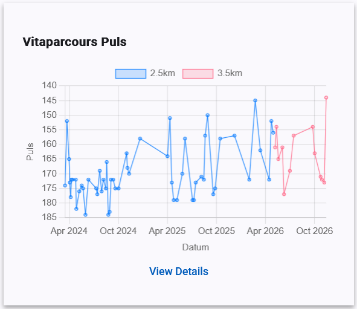

If wished, the datapoints can also be smoothed with a vairable smoothing rate.

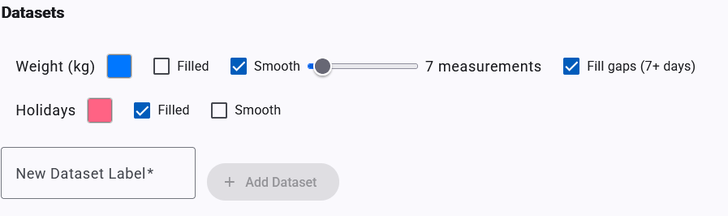

When smoothing is applied, there is also the option to fill gaps of more than 7 days, this helps because otherwise the
smoothing can make the smoothed graph look different than expected in the areas where data is missing:

Without filling the gaps:

With filling the gaps:
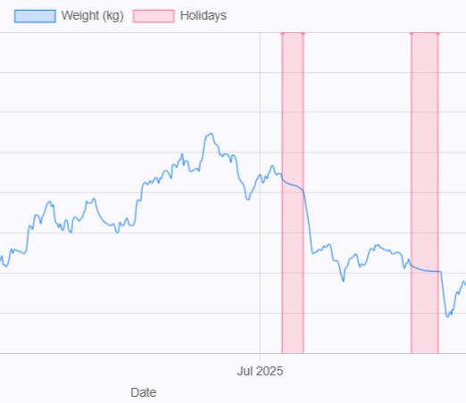

#### Stacked

Same as a normal line chart, but the datasets are stacked on each other, this needs at least 2 datasets to work.
Can be filled or unfilled

#### Dots & Trend

Instead of having all dots connected, the dots are still visible, but the line is replaced with a trend line, which is a
smoothed version of the normal line.

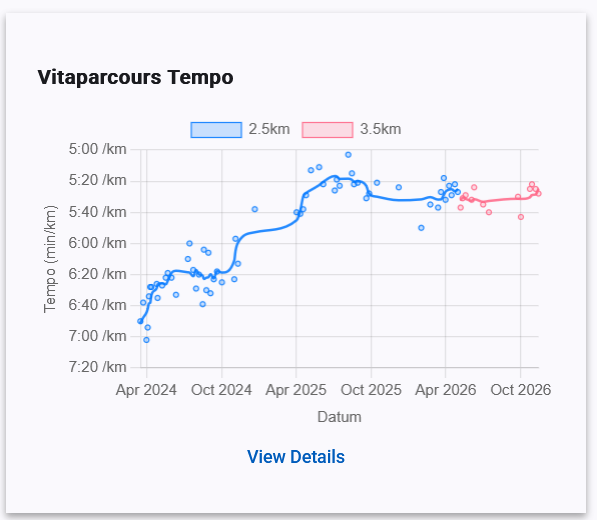

### Bar Chart

Shows the datapoints as bars, the only option is if they should be stacked or not.

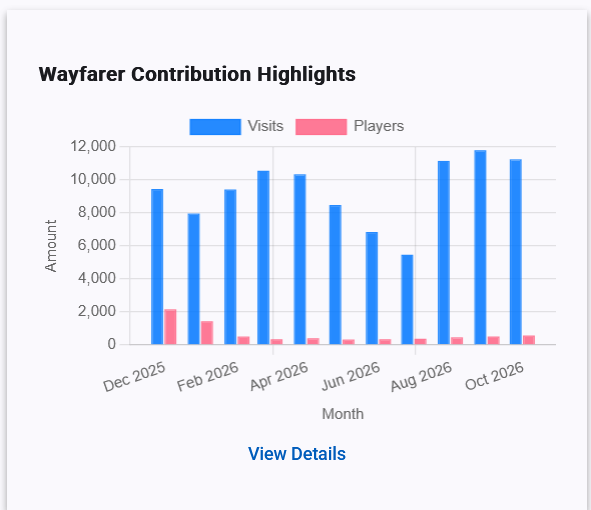 

## Value Types

At the moment there are 3 different value Types: Number, Percentage & Pace.

### Number

Number is the default, it has no unit, but you can have any string as a unit, which will be displayed next to it.

TODO: image of unit, I thought I've impemented that feature, maybe just for Y-Axis.

### Pace

Pace values use `m:ss` or `M.SS` notation (for example, `5.1` means `5:10`), datapoints can be entered like the
mentioned 5.1, as long as it is a valid pace number (not higher than 5.59)

### Percentage

Percentage values can be entered in 2 ways, as a raw percentage value, or as a number out of a total, from which the
total will be calculated. The Data itself is saved as the number, the percentage will be calculated out of the given
100% value.

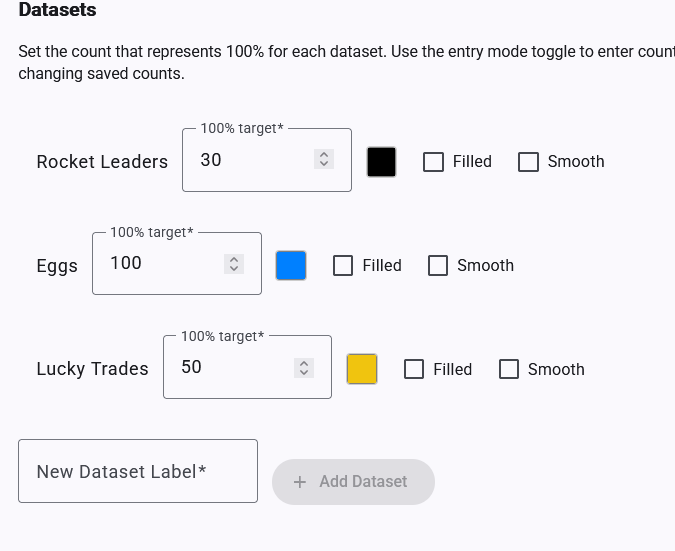

## Creating a Chart

Select **New Statistic** and fill in the chart settings:

| Field                        | What it controls                                                                                                                                        |
|------------------------------|---------------------------------------------------------------------------------------------------------------------------------------------------------|
| **ID**                       | A unique identifier for the chart.                                                                                                                      |
| **Title**                    | The title shown above the chart and on its overview card.                                                                                               |
| **Chart type**               | **Line** connects measurements; **Bar** displays them as bars.                                                                                          |
| **Dots + trend**             | For line charts, displays the recorded points and a trend line.                                                                                         |
| **Stacked**                  | Stacks datasets together for comparison.                                                                                                                |
| **X Axis Name**              | The label shown for the horizontal axis.                                                                                                                |
| **X Axis Scale**             | **Date / time** places measurements by date; **Numeric** places them by number. Numeric scales also have a **Numeric X Axis Unit** field, such as `km`. |
| **Y Axis Name**              | The label shown for the vertical axis.                                                                                                                  |
| **Value format**             | **Number**, **Pace (min/km)**, or **Percentage (%)** controls how values are displayed and entered.                                                     |
| **Y-axis minimum / maximum** | Optional lower and upper bounds. Leave blank to use automatic scaling. For pace charts, enter bounds in seconds (for example, `300` means `5:00`).      |
| **Reverse (lower = better)** | Reverses the vertical axis for measurements where lower values are better.                                                                              |

Select **Create** when the required fields are complete.

## View and edit a chart

Select **View Details** on a chart card to open the full chart. Hover over a chart point
to see its value and date. The legend identifies each dataset.

From the detail page:

- **Edit** opens chart settings.
- **Manage data** opens dataset and measurement tools.
- **Archive** moves the chart out of the active overview. Archived charts can be
  restored from **Archived Graphs**.
- **Delete** removes the chart after confirmation.

The edit page lets you change the chart title, chart type, **Dots + trend** and **Stacked** display options, X-axis
scale, Y-axis value format, and Y-axis bounds. For a numeric X axis, you can also set its unit. Save each section with
its own save button.

## Manage datasets

Open **Manage data**, then choose the **Manage Datasets** tab to:

- Change the X- and Y-axis labels with **Rename Axis Labels**.
- Add a dataset by entering a **New Dataset Label** and selecting **Add Dataset**.
- Rename, reorder, change the color of, or delete a dataset using its controls.
- Select **Filled** to fill the area beneath a dataset line.
- Select **Smooth** to smooth a dataset line. Adjust the measurement window to control
  how many measurements are used.
- For smoothed date-based datasets, select **Fill gaps (7+ days)** to show interpolated
  values across gaps of at least seven days.

For percentage charts, set a **100% target** for each dataset. This target is used to show its values as percentages.
The entry-mode control on the data page switches between entering counts and percentages.

### Add, edit, and delete measurements

In **Manage data**, choose **Add Data Point** to select a dataset and enter a
measurement:

- The X value is a **Date** for a date-based chart, or a number using the chart's
  numeric X-axis label for a numeric chart.
- The Y value uses the chart's selected value format.
- For number and percentage entries, enter a value or `+number` to add to that
  dataset's latest value. Pace values use `m:ss` or `M.SS` notation (for example,
  `5.1` means `5:10`) and do not support increments.
- On percentage charts, choose whether to enter counts or percentages using the
  entry-mode control.

Select **Add Point** to save the measurement.

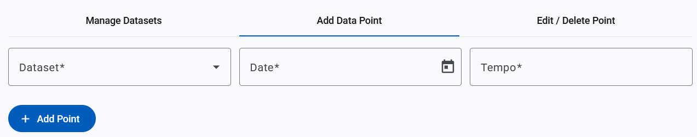

To edit or delete a measurement, open **Edit / Delete Point**, select its dataset and
the measurement, and enter a replacement value. Leave the value blank to delete the
measurement; confirm when prompted. You can also select a recorded point directly on
the chart to open it for editing.

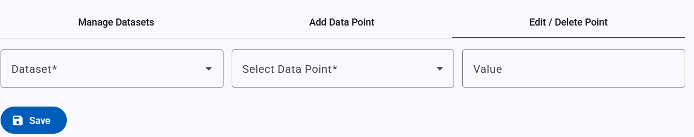

## Import measurements from CSV

Select **Import CSV** from the overview and follow the steps:

1. Select **Choose CSV** and choose a `.csv` file.
2. Select the **Date Column**. If the file has a column named `Date`, it is selected
   automatically.
3. If needed, enter a **Date Format**. Leave it blank for ISO or Swiss dates with an
   optional time. Custom formats use case-sensitive Luxon tokens; for example,
   `dd.MM.yyyy`, `MM/dd/yyyy`, `yyyyMMdd`, or `dd.MM.yyyy HH:mm:ss`. Specify a format
   for slash-separated dates to make the day/month order clear. A time in the date is
   discarded without changing the calendar date.
4. Optionally set **From date** and **To date** to limit the import. Both dates are
   included; leave either field blank to leave that side of the range unlimited.
5. Select the numeric measurement columns to import. Sample values are shown beside
   each column.
6. Choose **One Graph** to put the selected measurements in one chart, or **Separate
   Graphs** to make one chart per measurement.
7. Check the **Import Preview**. It lists each measurement's valid value count, first
   date, and first value. The preview also flags repeated dates, skipped rows or
   values, dates excluded by the range, and differing or unspecified units.
8. Select **Review Graph** or **Review Graphs**. Edit each chart's title, ID, and axis
   names, then confirm and select **Import Graphs**.

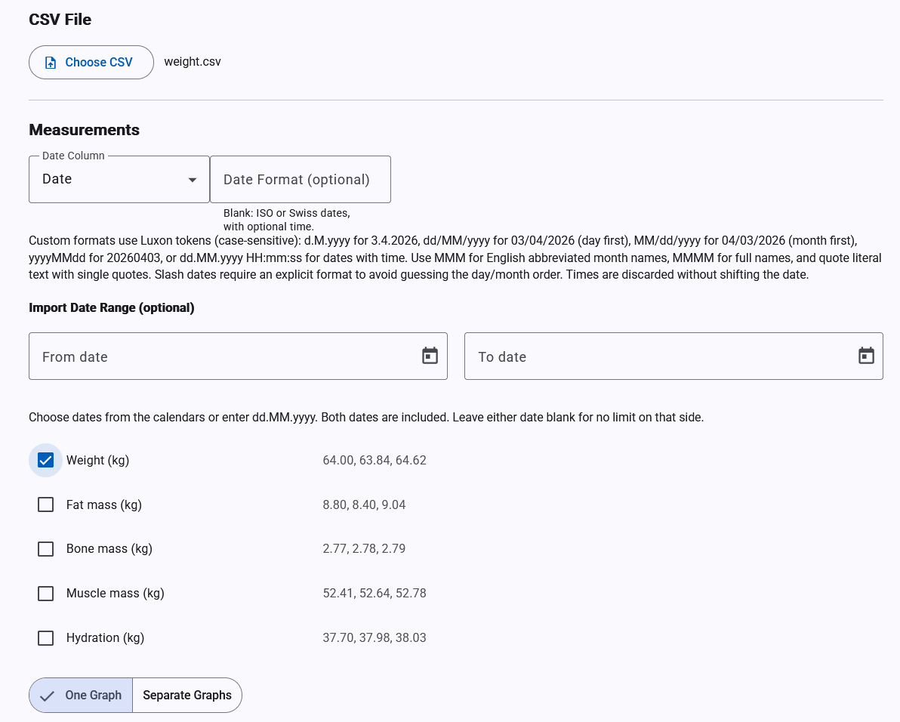

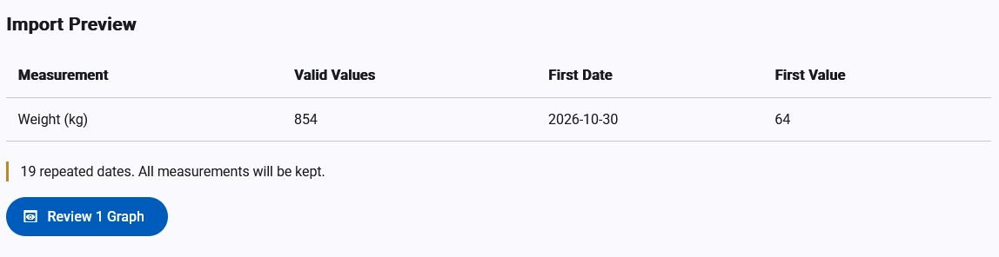

## Archived graphs

Select **Archived Graphs** from the overview to see archived charts. Open a chart to
review it or select **Unarchive** to return it to the active overview. Archived charts
cannot be edited or have their data managed until they are restored.

# Scoresaber Scatterplot

On the button of the Overview you find the Additional charts, the first of them is the Beatsaber Scatterplot, click on
view Details to get to the dedicated tool.

Players can be added with their scoresaber id, and scores for existing players can be updated. Player scores as well as
song information are saved locally, this way, if you improve a score, you can see the score moving up in accuracy as you
move the slider.

- **Update Scores** only loads all new scores for all players.
- **Update everything** also downloads all song information again, this is only needed when there is a ranking rebalance
  and
  star values change.

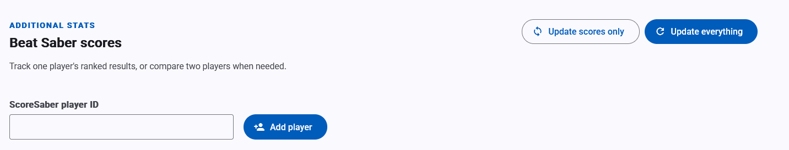

## Single Player

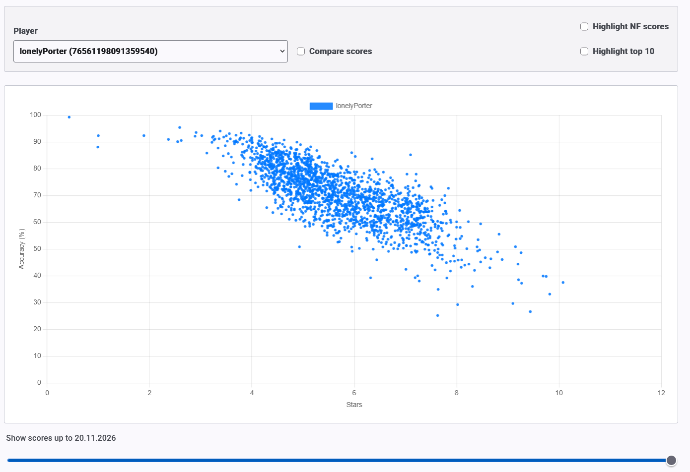

On the Overview you can see all the scores of the selected player and can see the values change over time with the
slider underneath the plot. Additionally, you can highlight all scores that used No Fail (NF), or your top 10 scores at
the moment. The top 10 are always directly loaded from the scoresaber API.

You can also select songs on the plot by clicking them, this way they are highlighted and shown next to the plot.
All selected songs (and difficulties) can then be exported as a beatsaber playlist.

## Compare Players

If you have entered at least 2 players, you can compare their scores.

If both players have played the same songs, their dots will be highlighted and connected with a line. YOu can also see
both scores in the hover tooltip with the player with the higher score on top.
There is even a dedicated filter to just show scores that both players have played.

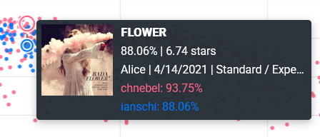