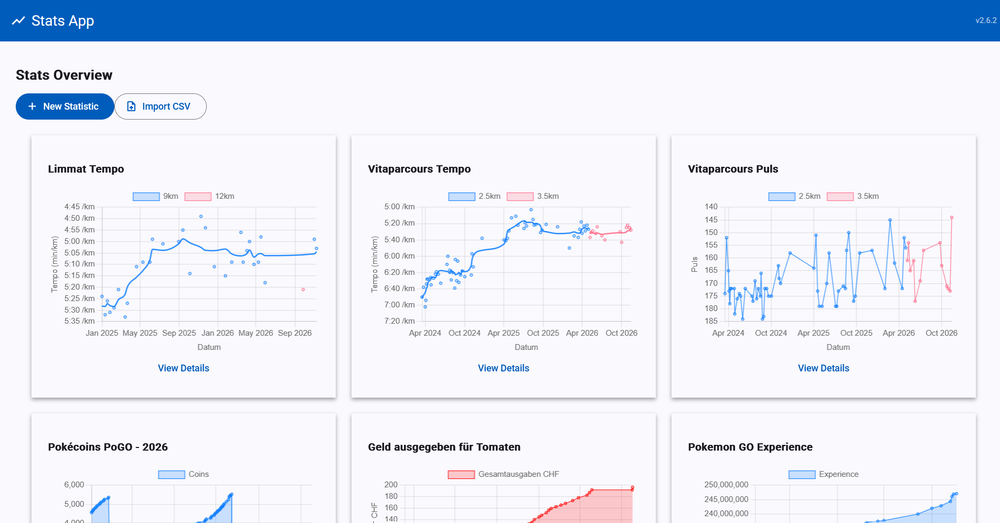
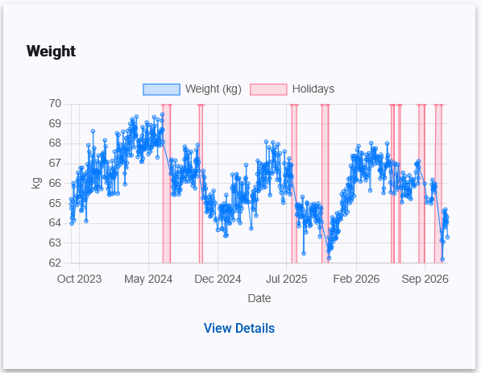
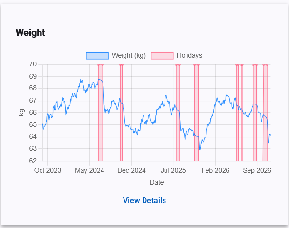
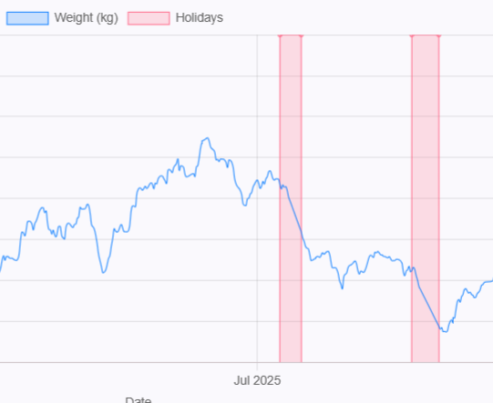
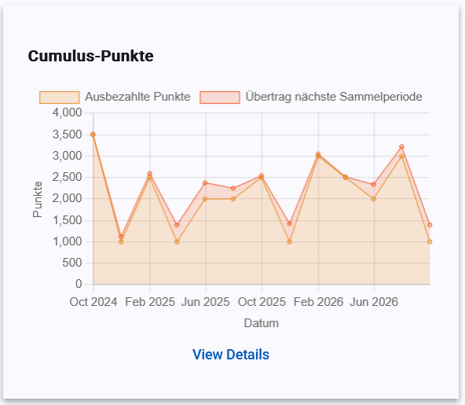
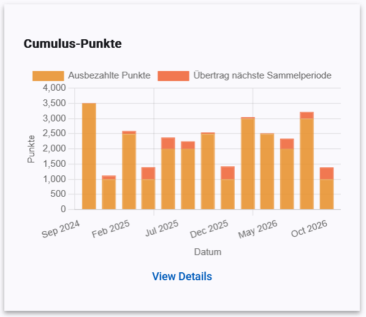
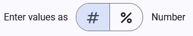

# Overview

Displays all managed (not archived) Charts, each Stat can be expanded for a bigger view and edit options by clicking
'View Details'.

## Chart Types

### Line Chart

#### Default

A normal line chart, each point in a dataset is connected by a line.
Can be filled or unfilled

If wished, the datapoints can also be smoothed with a vairable smoothing rate.

When smoothing is applied, there is also the option to fill gaps of more than 7 days, this helps because otherwise the
smoothing can make the smoothed graph look different than expected in the areas where data is missing:

Without filling the gaps:

With filling the gaps:

#### Stacked

Same as a normal line chart, but the datasets are stacked on each other, this needs at least 2 datasets to work.
Can be filled or unfilled

#### Dots & Trend

Instead of having all dots connected, the dots are still visible, but the line is replaced with a trend line, which is a
smoothed version of the normal line.

### Bar Chart

Shows the datapoints as bars, the only option is if they should be stacked or not.

 

## Value Types

At the moment there are 3 different value Types: Number, Percentage & Pace.

### Number

Number is the default, it has no unit, but you can have any string as a unit, which will be displayed next to it.

TODO: image of unit, I thought I've impemented that feature, maybe just for Y-Axis.

### Pace

Pace values use `m:ss` or `M.SS` notation (for example, `5.1` means `5:10`), datapoints can be entered like the
mentioned 5.1, as long as it is a valid pace number (not higher than 5.59)

### Percentage

Percentage values can be entered in 2 ways, as a raw percentage value, or as a number out of a total, from which the
total will be calculated. The Data itself is saved as the number, the percentage will be calculated out of the given
100% value.

